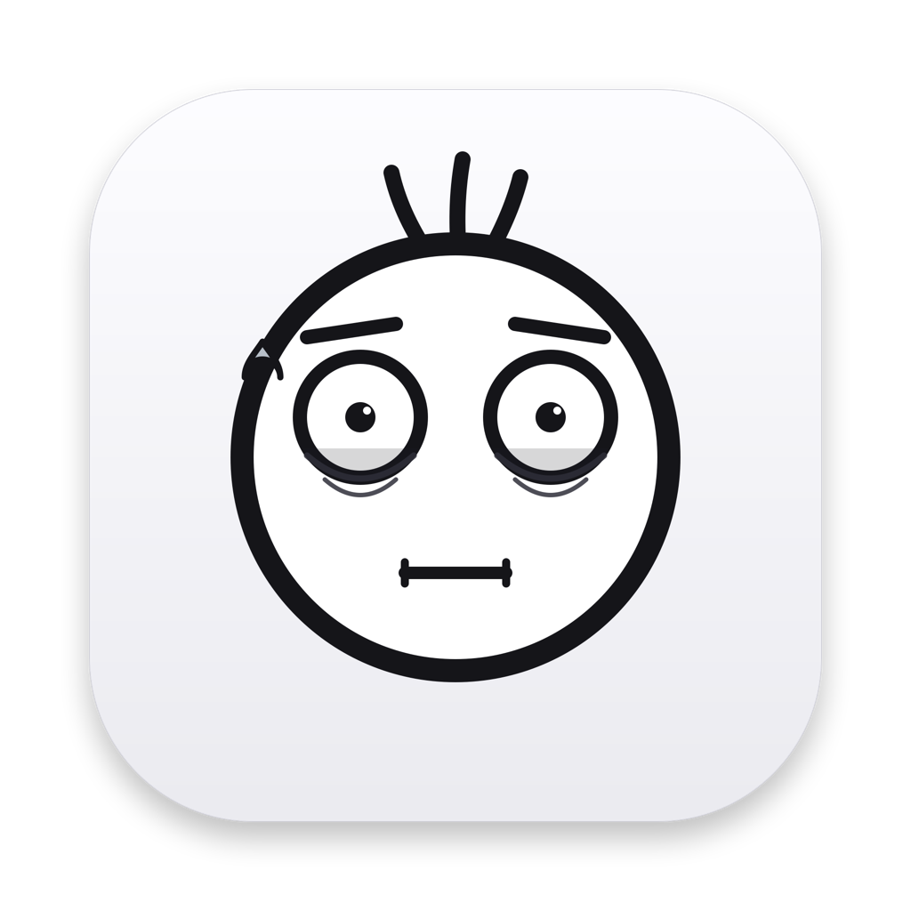

# Awake

<p align="center">
  
</p>

<p align="center">
  <strong>ให้ Mac ทำงานต่อจนกว่างานจะเสร็จ — แม้พับจอก็ไม่หลับ</strong><br>
  แอป Menu Bar และ CLI ขนาดเล็กสำหรับ macOS ออกแบบมาเพื่อ AI agents, งาน build และสคริปต์ที่ใช้เวลานาน
</p>

<p align="center">
  <a href="README.md">English</a> | <strong>ภาษาไทย</strong>
</p>

<p align="center">
  <a href="https://github.com/ChuBu0012/awake/releases"></a>
  <a href="LICENSE"></a>
  
  
  
</p>

<p align="center">
  <a href="https://github.com/ChuBu0012/awake/releases/latest/download/Awake.dmg">
    
  </a>
  &nbsp;&nbsp;
  <a href="https://github.com/ChuBu0012/awake/releases/latest/download/Awake.zip">
    
  </a>
  &nbsp;&nbsp;
  <a href="https://github.com/ChuBu0012/awake/releases">
    
  </a>
</p>

---

## การติดตั้งและเริ่มต้นใช้งาน

> **ความต้องการของระบบ**: macOS 12.0 (Monterey) ขึ้นไป (ไฟล์ Universal รองรับทั้ง Apple Silicon M1/M2/M3/M4 และ Intel)

| วิธีติดตั้ง | ลิงก์ดาวน์โหลด | รายละเอียด |
| :--- | :--- | :--- |
| **Disk Image (`.dmg`)** | [**ดาวน์โหลด Awake.dmg** (แนะนำ)](https://github.com/ChuBu0012/awake/releases/latest/download/Awake.dmg) | ตัวติดตั้งมาตรฐานของ macOS ลากลงโฟลเดอร์ `/Applications` แล้วใช้ได้ทันที |
| **ไฟล์บีบอัด (`.zip`)** | [**ดาวน์โหลด Awake.zip**](https://github.com/ChuBu0012/awake/releases/latest/download/Awake.zip) | แตกไฟล์แล้วเปิดใช้งานได้โดยตรง |
| **GitHub Releases** | [**ดูทุกเวอร์ชัน & Assets**](https://github.com/ChuBu0012/awake/releases) | รายการ Releases, Assets และ Changelog ทั้งหมด |

---

### ทางเลือกที่ 1: ติดตั้งผ่าน Disk Image (`.dmg`) — แนะนำที่สุด

1. ดาวน์โหลด [**`Awake.dmg`**](https://github.com/ChuBu0012/awake/releases/latest/download/Awake.dmg)
2. ดับเบิลคลิกไฟล์ `Awake.dmg` เพื่อเปิดหน้าต่างติดตั้ง
3. ลากไอคอน **`Awake.app`** ไปที่โฟลเดอร์ **`/Applications`**
4. เปิด **Awake** จาก Spotlight (<kbd>⌘</kbd> + <kbd>Space</kbd>) หรือ Launchpad

---

### ทางเลือกที่ 2: ติดตั้งผ่านไฟล์ ZIP (`.zip`)

1. ดาวน์โหลด [**`Awake.zip`**](https://github.com/ChuBu0012/awake/releases/latest/download/Awake.zip)
2. ดับเบิลคลิก `Awake.zip` เพื่อแตกไฟล์
3. ย้าย **`Awake.app`** ไปที่ `/Applications` (หรือเปิดใช้งานได้ทันที)

---

### การเปิดแอปครั้งแรก (Gatekeeper)

เนื่องจาก Awake เป็นโปรเจกต์โอเพนซอร์สอิสระที่ไม่ได้ซื้อใบรับรองรายปีจาก Apple หากเปิดครั้งแรกแล้ว macOS แจ้งเตือน:
> *"Awake cannot be opened because Apple cannot check it for malicious software"* หรือ *"แอปนี้มาจากนักพัฒนาที่ไม่ระบุชื่อ"*

**วิธีเปิดใช้งานครั้งแรก (ทำครั้งเดียว):**
1. เปิดโฟลเดอร์ **`/Applications`** ใน Finder
2. **คลิกขวา** (หรือกด <kbd>Control</kbd> แล้วคลิก) ที่ **`Awake.app`** แล้วเลือก **Open**
3. ในหน้าต่างยืนยัน ให้คลิก **Open**

> **สำหรับ macOS 15 Sequoia (หากไม่มีปุ่ม Open ในเมนูคลิกขวา):**
> - ไปที่ **System Settings (การตั้งค่าระบบ) > Privacy & Security (ความเป็นส่วนตัวและความปลอดภัย)** เลื่อนลงมาที่หัวข้อ **Security** แล้วคลิก **"Open Anyway"**
> - หรือปลดล็อกผ่าน Terminal ด้วยคำสั่ง:
>   ```bash
>   xattr -cr /Applications/Awake.app
>   ```

---

### ทางเลือกที่ 3: คอมไพล์จากซอร์สโค้ด (สำหรับ Developer & ผู้ใช้ CLI)

```bash
git clone https://github.com/ChuBu0012/awake.git
cd awake
make install
```

คำสั่งนี้จะคอมไพล์แอปไปไว้ที่ `~/Applications` และติดตั้ง CLI ไปที่ `~/.local/bin/awake` (ตรวจสอบให้แน่ใจว่า `~/.local/bin` อยู่ใน `$PATH` ของคุณ)

> **ทางลัด CLI สำหรับผู้ที่ติดตั้งผ่าน DMG / ZIP:**  
> ไฟล์ไบนารีของ CLI ถูกรวมอยู่ข้างใน `Awake.app` อยู่แล้ว สามารถทำ symlink ใช้งานได้ทันทีโดยไม่ต้องลง Go:
> ```bash
> mkdir -p ~/.local/bin && ln -sf /Applications/Awake.app/Contents/Resources/awake ~/.local/bin/awake
> ```

---

## ทำไมต้อง Awake?

| ปัญหาของเครื่องมือทั่วไป | วิธีที่ Awake แก้ปัญหา |
|---|---|
| พับจอ MacBook ลงแล้วเครื่องหลับทันที งานรันไม่เสร็จ | มีโหมดพับจอ (`pmset -a disablesleep 1`) และคืนค่าเดิมของระบบอัตโนมัติเมื่องานเสร็จ |
| กฎ "ตรวจจับแอปเปิดอยู่" ทำให้เครื่องไม่ยอมหลับทั้งวันแม้แอปจะ Idle | ตรวจจับ CPU จริง (>5%): เครื่องจะตื่นต่อเฉพาะตอนที่กระบวนการกำลังประมวลผลอยู่เท่านั้น |
| ลืมปิดการล็อกหน้าจอ แบตเตอรี่หมดหรือเครื่องร้อนในกระเป๋า | จำกัดเวลาสูงสุด 2 ชั่วโมงเมื่อพับจอบนแบตเตอรี่ และหยุดทำงานอัตโนมัติหากแบตต่ำกว่า 20% |
| ต้องคอยจำว่าต้องกดเปิดแอปที่ Menu Bar ก่อนลุกไปที่อื่น | มีคำสั่ง `awake run <cmd>` หรือ `awake hold` ให้ใส่ในสคริปต์หรือ Agent hook ได้โดยตรง |

---

## ความสามารถหลัก

- **ไม่ต้องใช้สิทธิ์ root หรือ sudo ในการใช้งานปกติ:** การล็อกไม่ให้หลับทั่วไปใช้มาตรฐาน Power Assertion ของ macOS (`/usr/bin/caffeinate`) ภายใต้สิทธิ์ผู้ใช้ธรรมดา
- **รองรับการพับจอทำงานต่อ (Lid-closed support):** ให้งานคอมไพล์ ดาวน์โหลด หรือ AI agent ทำงานต่อได้แม้จะพับหน้าจอลง
- **ตรวจจับงานอัจฉริยะ (Smart worker detection):** ตรวจสอบ Process ที่ระบุ (VS Code, Cursor, Node, Python, Xcode, Docker) โดยจะตื่นเฉพาะตอนที่กำลังใช้งาน CPU จริง และปล่อยให้เครื่องหลับทันทีที่งานเสร็จ
- **ระบบป้องกันเครื่องร้อนในกระเป๋า (Backpack protection):** จำกัดการตื่นขณะพับจอเมื่อใช้งานบนแบตเตอรี่ไม่เกิน 2 ชั่วโมง ป้องกันเครื่องร้อนจัดหรือแบตหมดในกระเป๋า
- **ระบบถนอมแบตเตอรี่และความร้อน:** พักการล็อกชั่วคราวเมื่อแบตเตอรี่ต่ำกว่า 20% หรือเมื่อระบบตรวจพบความร้อนสูง
- **Menu Bar popover และคีย์ลัดสะดวก:** แสดงตัวเลขนับถอยหลังแบบเรียลไทม์ พร้อมเหตุผลว่าทำไมเครื่องยังตื่นอยู่ รองรับคีย์ลัด (<kbd>⌘</kbd><kbd>T</kbd> สลับเปิด/ปิด, <kbd>⌘</kbd><kbd>,</kbd> ตั้งค่า, <kbd>⌘</kbd><kbd>Q</kbd> ออก)
- **เป็นส่วนตัว 100%:** ไม่มีการเชื่อมต่อเครือข่าย ไม่เก็บข้อมูล และไม่มี Telemetry ใดๆ ทั้งสิ้น

---

## คีย์ลัดในตัวแอป

เมื่อ Awake กำลังทำงาน:

| คีย์ลัด | คำสั่ง | รายละเอียด |
|:---:|:---|:---|
| <kbd>⌘</kbd> <kbd>T</kbd> | **Toggle Sleep Lock** | สลับเปิด/ปิดการล็อกไม่ให้หลับทันที |
| <kbd>⌘</kbd> <kbd>,</kbd> | **Preferences…** | เปิดหน้าต่างการตั้งค่า (Settings) |
| <kbd>⌘</kbd> <kbd>Q</kbd> | **Quit Awake** | ปล่อยการล็อกทั้งหมดและออกจากโปรแกรมอย่างปลอดภัย |

---

## การเชื่อมต่อกับ AI Agent และสคริปต์

Awake ออกแบบมาให้เรียกใช้งานผ่าน Terminal ได้ง่าย เหมาะสำหรับใช้งานร่วมกับ AI Agent (Claude Code, Cursor, Windsurf, OpenHands) หรือ Shell Script:

### วิธีที่ 1: ครอบคำสั่งด้วย `awake run`
ครอบคำสั่งที่ต้องการรัน เมื่อเริ่มทำงาน Awake จะขอสิทธิ์ตื่น และจะปล่อยคืนระบบทันทีที่คำสั่งทำงานเสร็จ:

```bash
# รัน Build หรือทดสอบ
awake run npm run build

# รัน Docker Container
awake run docker compose up --build

# รัน AI Agent
awake run claude
```

### วิธีที่ 2: ขอและปล่อยสิทธิ์ด้วย `awake hold` / `awake release`
เหมาะสำหรับรันในสคริปต์หลายขั้นตอน หรือรันใน Agent Hook:

#### ใน Shell Script:
```bash
# ขอสิทธิ์ตื่นพร้อมตั้งเวลาหมดอายุอัตโนมัติ 45 นาทีกันลืม
awake hold "nightly-agent-sync" --ttl 45m

# รันงานที่ต้องใช้เวลานาน...
python3 run_agent_workflow.py

# ปล่อยสิทธิ์เมื่องานเสร็จ
awake release "nightly-agent-sync"
```

#### ใน Python:
```python
import subprocess

def keep_awake(session_id: str, ttl: str = "30m"):
    subprocess.run(["awake", "hold", session_id, "--ttl", ttl], check=True)

def release_awake(session_id: str):
    subprocess.run(["awake", "release", session_id], check=True)

# การใช้งาน:
keep_awake("agent-session-1", ttl="1h")
try:
    run_agent_task()
finally:
    release_awake("agent-session-1")
```

#### ใน Node.js / TypeScript:
```typescript
import { execFileSync } from "child_process";

export function holdSleep(leaseId: string, ttl = "30m"): void {
  execFileSync("awake", ["hold", leaseId, "--ttl", ttl]);
}

export function releaseSleep(leaseId: string): void {
  execFileSync("awake", ["release", leaseId]);
}
```

---

## คำสั่ง CLI

เครื่องมือคำสั่ง `awake` ใช้สำหรับควบคุมและตรวจสอบระบบจาก Terminal:

| คำสั่ง | ตัวอย่างการใช้งาน | คำอธิบาย |
|---|---|---|
| `awake on [ระยะเวลา]` | `awake on 2h` | เปิดการล็อกไม่ให้หลับ (`30m`, `1h`, `2h`, `4h`, `8h`, `indefinite`) |
| `awake off` | `awake off` | ปิดการล็อกด้วยตนเอง (ระบบตรวจจับเบื้องหลังยังคงทำงานต่อตามปกติ) |
| `awake status [--json]` | `awake status --json` | ดูสถานะการทำงานปัจจุบัน, งานที่ขอตื่นอยู่ และระดับแบตเตอรี่ |
| `awake run <คำสั่ง...>` | `awake run make test` | รันคำสั่งพร้อมขอสิทธิ์ไม่ให้หลับ และปล่อยคืนอัตโนมัติเมื่องานจบ |
| `awake hold <id> [--ttl <เวลา>]` | `awake hold agent-1 --ttl 1h` | ขอสิทธิ์ไม่ให้หลับสำหรับสคริปต์ พร้อมกำหนดเวลาหมดอายุเพื่อความปลอดภัย |
| `awake release <id>` | `awake release agent-1` | ปล่อยสิทธิ์ที่ขอไว้ |
| `awake rule ...` | `awake rule process p1 "Build" "ninja"` | จัดการกฎการตรวจจับแอปและ Process |
| `awake set <ระบบป้องกัน> on\|off` | `awake set battery-guard on` | เปิด/ปิด `battery-guard` หรือ `lid-support` |
| `awake verify` | `awake verify` | ตรวจสอบการทำงานของ Power Assertion จากระบบ macOS โดยตรง |
| `awake setup` | `awake setup` | ตั้งค่า sudoers สำหรับคำสั่ง `pmset` (สำหรับการพับจอทำงานต่อ) |
| `awake recover` | `awake recover` | คืนค่าสถานะระบบให้กลับมาหลับตามปกติในกรณีที่โปรแกรมปิดกะทันหัน |

### วิธีทดสอบว่า Mac ไม่หลับจริง

หากต้องการทดสอบการทำงานของ Awake:

```bash
# รัน Script นับเลขผ่าน Awake (ทดสอบ 60 วินาที)
awake run ./scripts/sleep-test-counter.sh 60

# หรือรันต่อเนื่อง (กด Ctrl+C เพื่อหยุด)
./scripts/sleep-test-counter.sh
```

สคริปต์จะบันทึก Timestamp ทุกๆ 1 วินาที หากเครื่องเข้าโหมดหลับ ตัวเลขนับจะหยุดเดิน และจะแจ้งเตือนทันทีเมื่อเครื่องตื่น

---

## ความปลอดภัยของโหมดพับจอ

ตามปกติ macOS จะบังคับให้โน้ตบุ๊กเข้าโหมดหลับเมื่อพับจอลง เว้นแต่จะเสียบปลั๊กชาร์จไฟและต่อจอแยกไว้

เพื่อให้ MacBook สามารถทำงานต่อบนแบตเตอรี่ขณะพับจอได้ Awake มีตัวเลือกสั่งคำสั่ง `pmset -a disablesleep 1` โดยกำหนดกฎ sudoers ผ่านคำสั่ง `awake setup` (หรือคลิกตั้งค่าจากหน้าแอป):

```sudoers
username ALL=(ALL) NOPASSWD: /usr/bin/pmset -a disablesleep 0, /usr/bin/pmset -a disablesleep 1
```

- **จำกัดสิทธิ์เฉพาะคำสั่ง:** อนุญาตเฉพาะคำสั่ง `pmset` สองคำสั่งนี้เท่านั้น Awake ไม่สามารถรันคำสั่งอื่น หรือเข้าถึงข้อมูลส่วนตัวใดๆ ได้
- **คืนค่าระบบเดิมเสมอ:** Awake จะบันทึกค่า Sleep เดิมของเครื่องไว้ และคืนค่าทันทีที่งานสุดท้ายทำงานเสร็จสิ้น
- **ถอนการติดตั้งได้ทันที:** สามารถลบการตั้งค่า sudoers ได้ตลอดเวลาผ่าน `sudo rm -f /etc/sudoers.d/awake` หรือสั่ง `make uninstall`

---

## การถอนการติดตั้ง

ลบ Awake, CLI, ไฟล์ตั้งค่า และกฎ sudoers ออกจากเครื่องอย่างสมบูรณ์:

```bash
make uninstall
```

หรือลบด้วยตนเอง:
```bash
rm -f ~/.local/bin/awake
rm -rf ~/Applications/Awake.app ~/.config/awake
sudo rm -f /etc/sudoers.d/awake
sudo visudo -c
```

---

## การมีส่วนร่วม

ยินดีต้อนรับการมีส่วนร่วม รายงานบั๊ก และข้อเสนอแนะจากทุกคนครับ!

- [คู่มือการมีส่วนร่วม (Contributing Guide)](CONTRIBUTING.md)
- [นโยบายความปลอดภัย (Security Policy)](SECURITY.md)
- [การติดต่อและช่วยเหลือ (Support)](SUPPORT.md)
- [ข้อพึงปฏิบัติร่วมกัน (Code of Conduct)](CODE_OF_CONDUCT.md)
- [ประวัติการเปลี่ยนแปลง (Changelog)](CHANGELOG.md)

---

## สัญญาอนุญาต (License)

Awake เผยแพร่ภายใต้สัญญาอนุญาต [MIT License](LICENSE)
