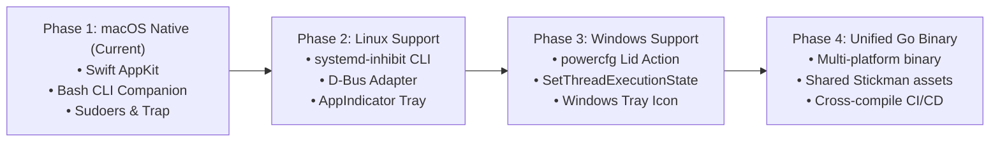

# Awake Cross-Platform Architecture Specification (Spec-Kit)

## Intent

Extend **Awake** beyond macOS to become a universal, zero-friction sleep-prevention utility for AI agents and long-running developer tasks across **macOS**, **Linux**, and **Windows**.

The system must deliver an identical mental model, CLI syntax, and Mascot-driven Menu Bar/System Tray experience on every platform, while cleanly abstracting the OS-specific power management APIs and privilege boundaries.

---

## Goals

1. **Uniform CLI Interface**: Ensure commands (`awake on`, `awake off`, `awake status`, `awake run <cmd>`) behave identically on macOS, Linux, and Windows.
2. **True Clamshell / Lid-Closed Support on All OSes**:
   - macOS: `pmset -a disablesleep 1` + `caffeinate`
   - Linux: `systemd-inhibit --what=sleep:idle:handle-lid-switch`
   - Windows: `powercfg /setacvalueindex ... LIDACTION 0` + `SetThreadExecutionState`
3. **Identical System Tray / Menu Bar Mascot Experience**:
   - Deliver the signature **Awake Stickman** mascot across all OSes:
     - **Active**: Wide-eyed staring face `( O_O )` with tired dark eye bags.
     - **Inactive**: Peaceful sleeping face `( -_- )` with floating `z`.
   - Native system tray integration: macOS (Menu Bar), Windows (Notification Area), Linux (AppIndicator / StatusNotifierItem).
4. **Single-Binary or Zero-Dependency Packaging**:
   - Minimize memory footprint (< 20 MB RAM).
   - Fast cold start (< 50 ms).
   - Avoid Electron or heavy runtimes (no Node.js/Python required on client machines).
5. **Least-Privilege Security**:
   - Never require root/admin for operations that can run in user space.
   - For operations requiring elevated privileges (e.g. macOS `pmset`, Windows Power Plans), keep commands narrowly scoped and idempotent.

---

## Non-Goals

- Building a heavy web-based dashboard or Electron GUI.
- Cloud telemetry, remote device management, or network syncing.
- Bypassing corporate enterprise Group Policies that enforce sleep lockouts.
- Replacing full-fledged system power schedulers (Awake is task- and agent-focused).

---

## Architectural Design

### 1. Unified Architecture Pattern: "Engine Adapter Model"

```
                         ┌───────────────────────────────────────────────┐
                         │               Awake Controller                │
                         │  - State Machine (Active / Inactive / Expired)│
                         │  - Duration & Battery Watchers                │
                         │  - CLI Routing & Signal Trap Lifecycles       │
                         └───────────────────────┬───────────────────────┘
                                                 │
                     ┌───────────────────────────┴───────────────────────────┐
                     ▼                                                       ▼
         ┌───────────────────────┐                               ┌───────────────────────┐
         │     Tray UI Layer     │                               │   Power Engine Port   │
         │ (Stickman Dynamic UI) │                               │  (Abstract Interface) │
         └───────────┬───────────┘                               └───────────┬───────────┘
                     │                                                       │
       ┌─────────────┼─────────────┐                           ┌─────────────┼─────────────┐
       ▼             ▼             ▼                           ▼             ▼             ▼
   [macOS]       [Linux]       [Windows]                   [Darwin]       [Linux]      [Windows]
 AppKit / Cocoa AppIndicator Shell_NotifyIcon             pmset+caff   systemd-inhibit powercfg+Win32
```

---

### 2. OS-Specific Power Engines (The Adapter Layer)

#### A. Darwin / macOS Engine (`engine_darwin`)
* **Lid-closed sleep prevention**: `sudo /usr/bin/pmset -a disablesleep 1|0`
* **Idle & kernel sleep prevention**: `caffeinate -dism &`
* **Security boundary**: One-time sudoers rule at `/etc/sudoers.d/awake` granting NOPASSWD for `/usr/bin/pmset -a disablesleep 0` and `/usr/bin/pmset -a disablesleep 1`.
* **State location**: `${XDG_CONFIG_HOME:-~/.config}/awake/state.json` (fallback: `/tmp/awake-$UID`).

#### B. Linux Engine (`engine_linux`)
* **Lid-closed & system sleep prevention**: Uses standard systemd inhibition:
  ```bash
  systemd-inhibit --what=sleep:idle:handle-lid-switch --who="Awake" --why="Running AI Agent" <cmd>
  ```
* **D-Bus Native Path**: Calls `org.freedesktop.login1.Manager.Inhibit` directly over the system D-Bus.
* **Security boundary**: **Zero sudo required**. Standard desktop user sessions have permission to inhibit sleep through Polkit.
* **State location**: `${XDG_CONFIG_HOME:-~/.config}/awake/state.json`.

#### C. Windows Engine (`engine_windows`)
* **Lid-closed sleep prevention**:
  - Sets active AC Power scheme lid-close action to 0 (Do Nothing):
    ```cmd
    powercfg /setacvalueindex SCHEME_CURRENT SUB_BUTTONS LIDACTION 0
    powercfg /setactive SCHEME_CURRENT
    ```
  - Restores to 1 (Sleep) upon deactivation.
* **Idle & system sleep prevention**:
  - Win32 API: `SetThreadExecutionState(ES_CONTINUOUS | ES_SYSTEM_REQUIRED | ES_DISPLAY_REQUIRED)`
* **Security boundary**: Standard user privileges for `SetThreadExecutionState`; standard user or UAC prompt for active power scheme modifications if restricted.
* **State location**: `%APPDATA%\awake\state.json`.

---

### 3. Recommended Technology Stack for Multi-Platform

| Component | Recommended Technology | Rationale |
|---|---|---|
| **Core Runtime** | **Go (Golang 1.23+)** | Single executable for both CLI and Tray; built-in cross-compilation (`GOOS=windows/linux/darwin`); ~15MB RAM; instant startup. |
| **Alternative Runtime** | **Rust + `tray-icon`** | Exceptional safety, ~5MB binary; slightly more complex cross-compilation pipeline than Go. |
| **System Tray UI** | `github.com/getlantern/systray` (Go) | Proven native bindings for Cocoa (`NSStatusItem`), Win32 (`Shell_NotifyIcon`), and Linux (`libappindicator`). |
| **Process / Command Runner** | Native Go `os/exec` with Signal Trap | Clean `os.Interrupt`, `syscall.SIGTERM`, and Windows `os.Kill` handling ensuring guaranteed state restoration. |

---

### 4. Cross-Platform Directory & State Schema

#### State File: `state.json`
```json
{
  "version": "1.0.0",
  "platform": "darwin|linux|windows",
  "active": true,
  "started_at": 1700000000,
  "duration_seconds": 7200,
  "expires_at": 1700007200,
  "inhibitor_pid": 12345,
  "battery_guard_enabled": true,
  "mode": "manual|wrapper|schedule"
}
```

---

## Phased Implementation Roadmap



### Phase 1: macOS Native (Complete)
* [x] Native Swift AppKit Menu Bar App (`Awake.app`) with custom Stickman icons.
* [x] POSIX/Bash CLI companion (`awake`) with wrapper execution and signal trapping.
* [x] Sudoers helper for narrow `pmset -a disablesleep` privileges.
* [x] Battery Guard (< 20%) & Timer duration presets.

### Phase 2: Linux CLI & Inhibit Integration
* [ ] Implement `engine/linux.go` (or `bin/awake-linux.sh`).
* [ ] Support `systemd-inhibit` for lid-close and idle sleep.
* [ ] Fallback support for non-systemd environments (`xset`, `xdg-screensaver`).
* [ ] Packaging: `.deb`, `.rpm`, and Arch Linux PKGBUILD.

### Phase 3: Windows CLI & Win32 Integration
* [ ] Implement `engine/windows.go` (or `bin/awake.ps1`).
* [ ] Implement `powercfg LIDACTION` toggle and `SetThreadExecutionState` loop.
* [ ] Handle Windows terminal signals (`CTRL_C_EVENT`, `CTRL_BREAK_EVENT`).
* [ ] Packaging: `.zip` standalone portable binary and winget manifest.

### Phase 4: Unified Multi-Platform Binary
* [ ] Unify CLI and Tray app into single Go repository (`cmd/awake/main.go`).
* [ ] Embed Stickman vector assets (PNG for macOS/Linux, ICO for Windows).
* [ ] Automated GitHub Actions CI producing multi-arch binaries (`darwin-arm64`, `darwin-amd64`, `linux-amd64`, `linux-arm64`, `windows-amd64.exe`).

---

## Verification & Acceptance Criteria

1. **Lid-Closed Verification**:
   - On each target platform, closing the laptop lid while an AI Agent runs must **not** sleep the device, drop network connectivity, or kill background processes.
2. **Crash & Termination Safety**:
   - Sending `SIGINT` (Ctrl+C), `SIGTERM`, or terminating the terminal process must cleanly restore the system's original sleep settings immediately.
3. **Mascot Fidelity**:
   - The Stickman icon must render crisply on High-DPI / Retina displays on all platforms (16px, 32px, 64px, and 1024px).
